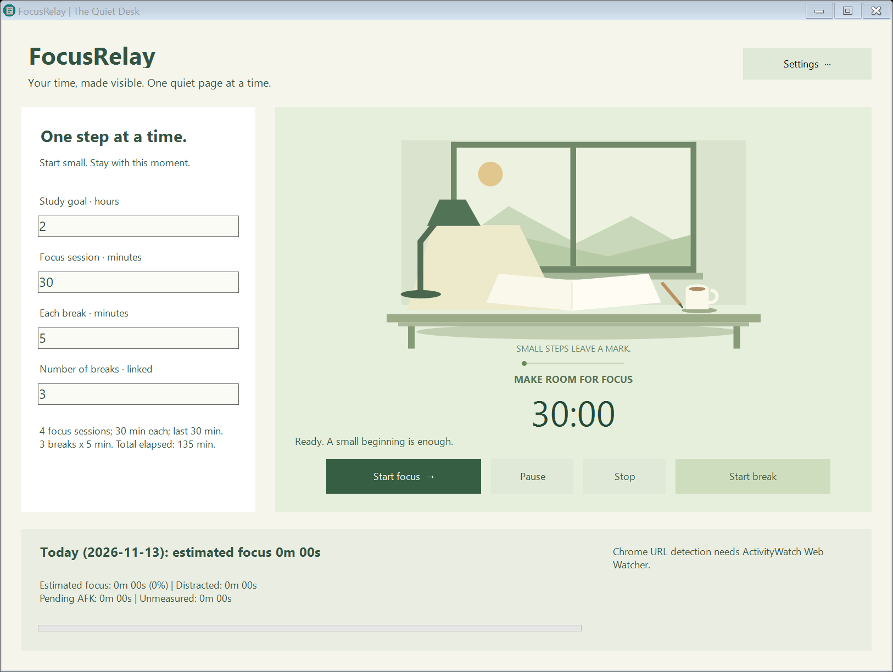
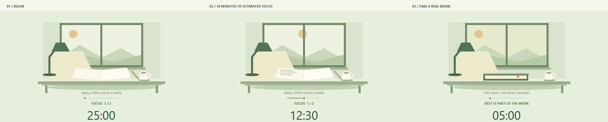

# FocusRelay

**A personalised focus and time-management companion for Windows.**

I built this personal project for coursework, side projects and other computer-based work. It combines flexible work-and-break planning, configurable reminders, activity-based focus estimates and optional phone notifications.

**Windows x64 · Portable EXE · AI-assisted development**



*The current desktop interface, shown with an empty session rather than personal activity records.*

## Why I built it

A timer can tell me a work block has ended without knowing whether I have finished the task in front of me. If a break starts automatically while I am still working, part of that break is already gone by the time I stop.

I wanted to finish a task without losing my break, adjust reminders to different activities, and receive a nudge on my phone when away from the computer. I tested the tool in my own routine and refined both the workflow and interface.

## Changes shaped by actual use

| Problem | Design change | Purpose |
| --- | --- | --- |
| A break could start before I stopped working. | Added **Start break** confirmation; extra work is recorded separately. | Preserve the full planned break. |
| A desktop-only reminder could be missed away from the computer. | Integrated optional **ntfy** phone notifications. | Reach me without claiming to monitor phone use. |
| Missing activity records could distort the statistics. | Kept **unmeasured time** separate from estimated focus and distraction. | Avoid treating missing observations as productive time. |
| Planning, reminder settings and diagnostics shared one screen. | Moved less-frequent controls into **Settings**. | Keep the main plan, timer and session actions easier to follow. |

## Visual feedback with a clear meaning

The desk scene makes the session state visible:

- The timer, daylight and small timeline follow elapsed interval time.
- Notebook marks reflect **estimated focus credited in the current interval**, not every elapsed second.
- Pausing preserves the page. A break closes the book and shows steam above the cup.
- Each new work interval starts a fresh page. Pages are a visual metaphor, not saved notes or collectibles.



*These state previews use test data. They are not a record of real attention, learning or productivity.*

## Display scaling (DPI)

The EXE declares **Per-Monitor V2 DPI awareness**. Window layout, fonts and the desk illustration scale for the display; the main and settings windows handle DPI changes and allow scrolling when the layout exceeds the available work area.

Layout fixtures were checked at **100%, 125%, 150% and 200%** on a Windows display running at 150%. These checks do not establish compatibility with every mixed-monitor configuration. See the [verification record](docs/VALIDATION.md) for the scope of testing.

## My contribution and use of AI

I defined the goals and requirements, decided how the workflow should behave, tested it in my routine and used what I observed to guide revisions. This included protecting breaks, requesting editable rules and daily summaries, questioning the treatment of missing data, and identifying interface faults.

I used **Codex** to research open-source options and perform much of the coding. My responsibility was to evaluate the result and decide what needed to change. ActivityWatch supplies the activity records, while ntfy supplies the optional phone notification channel.

**AI-assisted development describes how the application was built. It does not use an AI model to detect attention.**

## Run the Windows app

1. Extract the **complete Windows portable ZIP** into a writable folder. Keep the supplied `app/` folder and `FocusRelay.exe.config` beside the EXE. Settings and history are stored in `data/`.
2. Install and start **ActivityWatch Classic**, including its window watcher. This supplies foreground-application data.
3. Open **`FocusRelay.exe`**. For Chrome webpage reminders, install ActivityWatch Web Watcher through **Settings → Chrome extension**.
4. Start a focus session and check the status. **Website detection active** confirms URL coverage for the foreground browser; **App monitoring active** alone does not confirm webpage detection.

The EXE opens the graphical application without a terminal window. It is a **portable launcher**, not an installer or a self-contained single-file application. ActivityWatch is a separate requirement and is not bundled.

- [Setup, daily use, building and verification](docs/SETUP.md)
- [Current verification results and remaining checks](docs/VALIDATION.md)
- [Launcher](src/launcher/Program.cs) · [Build script](scripts/Build.ps1)
- [Interface layout](src/app/ui/desk-theme.ps1) · [Desk illustration](src/app/ui/DeskScene.cs)

A source download does not include the compiled executable; the portable Windows ZIP is a separate release asset.

## What I learned

A tool can run correctly but still behave in an unhelpful way. Actual use helped me turn vague preferences into specific requirements, integrate existing capabilities, and distinguish plausible statistics from measurements I could defend.

AI made implementation more accessible. It did not remove the need to question assumptions, test the behaviour and take responsibility for the result.

## Limitations and privacy

Focus is **estimated from computer activity**, not measured directly. Reading or working on paper may appear idle; an unlisted foreground activity may count as estimated focus. This is a reminder tool, not a website blocker or phone-usage monitor.

Sleep, watcher coverage, connectivity and notification permissions can interrupt reminders. A successful push submission does not prove phone delivery. This remains a personal prototype, without measured productivity gains or broad testing on other users' computers.

**Observed integration limitation:** live checks confirmed webpage recognition, but some matching Chrome records were older than the current 25-second freshness limit and were rejected. The cause of those delays has not been isolated, and uninterrupted webpage coverage is not yet verified. See the [verification record](docs/VALIDATION.md).

ActivityWatch may retain URLs and window titles locally. Configuration and diagnostic logs may reveal habits. Do not publish personal configuration, logs, activity records or screenshots that expose them.

### Optional phone notifications

- Each fresh configuration generates a random ntfy topic locally. The app does not send this topic to the project author or provide an author-managed dashboard for viewing users' topics.
- The topic is stored in plain text in local `data/config.json`. Access depends on folder permissions: another account, administrator or program with permission to read that file can also read the topic. Local storage is not an additional encryption layer.
- When phone reminders are enabled, the topic and reminder messages are sent over HTTPS to `ntfy.sh`; the phone also stores its subscription. Only reminder messages are sent, not browsing URLs, window titles or activity histories.
- Treat the complete topic name like a password. The current integration has no additional account authentication: someone who obtains the topic may subscribe or publish to it. See [ntfy's access-control documentation](https://docs.ntfy.sh/config/#access-control) and [privacy policy](https://docs.ntfy.sh/privacy/).

Share the clean distribution without personal `config.json`, and keep topics out of screenshots, support requests and public repositories. Phone reminders are disabled by default.

## Acknowledgements and licensing

Built with [ActivityWatch](https://github.com/ActivityWatch/activitywatch), [ActivityWatch Web Watcher](https://github.com/ActivityWatch/aw-watcher-web) and [ntfy](https://ntfy.sh/). This is an independent project, not an official product of those projects.

No project `LICENSE` has been added yet. Third-party components remain subject to their own licences.


## Project layout

```text
FocusRelay/
  src/        # EXE launcher and application modules
  scripts/    # Build and clean distribution packaging
  tests/      # Timer, accounting, reminder and UI fixtures
  docs/       # Setup and verification records
  assets/     # Reviewed screenshots for this page
  .github/    # Windows build workflow
  README.md
```

The portable distribution has a separate layout: `FocusRelay.exe`, its configuration, `app/` for supporting code, and `data/` created on first launch. No CMD launcher is required. Build outputs are ignored under `artifacts/` rather than mixed into the source tree. Reorganizing the modules does not combine them into a single-file executable.